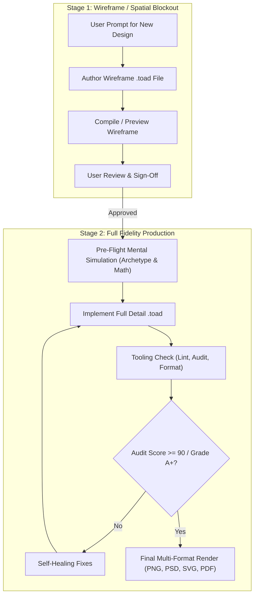

# TOAD Design Architect & Engineering Skill (`v3.3`)

> **TOAD WORKSPACE RULE**: In TOAD workspaces (e.g. `toad`, `toad-designs`, `toad-dev`) or when working on TOAD projects, **ALL visual designs are TOAD designs** (`.toad` / `.toadm`). Never output raw HTML/CSS, generic SVG, or fallback formats unless explicitly requested.

---

## 1. Core Principles & Quality Standards

- **Wireframe First Protocol**: Before generating any full detailed visual design from scratch, always provide a rough visual wireframe / spatial blockout `.toad` file for user sign-off.
- **100% Compiler Validity**: Strict adherence to the AST schema without syntax or token errors.
- **Grade A+ (100 / 100) Audit Standard**: Mathematically guaranteed compliance with all 26 Anti-AI-Slop heuristics, WCAG 2.2 / APCA contrast requirements, and layout non-collision rules (`toad report --strict`).
- **Comprehensive Toolchain Mastery**: Full exploitation of TOAD tools (compiler, live server, linter, auditor, formatter, bundler, motion engine, and on-device neural AI tools).

---

## 2. The 2-Stage Design Creation Workflow



---

### Stage 1: The Wireframe-First Protocol (Mandatory for New Designs)

Whenever creating a **new** design from scratch, do NOT jump directly into full color palettes, deep shadows, and detailed assets. First create a **rough visual layout plan (`.toad`)**:

1. **Purpose**:
   - Establish canvas dimensions and safe margins.
   - Define macro-containers (`stack`, `grid`, `group`) with outline borders and low-opacity fills.
   - Display placeholder bounding boxes with clear structural labels (e.g., `"[HERO METRIC CARD: 464x424]"`, `"[SPARKLINE GRAPH]"`).
   - Verify negative space (whitespace between 40% and 65%) and spine gutter spacing before detailing.
2. **Wireframe Palette Convention**:
   - Canvas: Neutral dark (`#0c0a09` / `#030712`) or neutral paper (`#f4f1ea`).
   - Wireframe Containers: `stroke: #38bdf8 1px dashed; fill: alpha(#38bdf8, 0.05);` or `stroke: #18181b 1px; fill: alpha(#000000, 0.04);`.
   - Labels: Monospace uppercase font (`@font "Space Grotesk" bold;`), `font-size: 13px; line-height: 20px; letter-spacing: 1.5px;`.
3. **User Sign-Off**:
   - Present the `.toad` wireframe to the user, render a preview if desired, and request confirmation before advancing to production styling.

---

### Stage 2: Full Fidelity Production Workflow

Once the structural wireframe is approved:

#### Step 1: Pre-Flight Mental Simulation
Before generating the final `.toad` code, verify the four pillars of the TOAD design auditor:
1. **Archetype & Contrast Lock**:
   - Choose 1 Primary Archetype (`A01`–`A12` from [visual_archetypes.md](./references/visual_archetypes.md)).
   - Verify that every text `< 24px` satisfies **WCAG >= 4.5:1** AND **APCA |Lc| >= 75**.
   - On dark surfaces (`#030712`..`#1e293b`), NEVER use `#64748b`, `#94a3b8`, or `#38bdf8` for small text. Use `#f8fafc`, `#e2e8f0`, or `#bae6fd` (`|Lc| >= 84`).
   - On light surfaces (`#ffffff`..`#f3efe6`), use `#0f172a`, `#18181b`, or deep crimson `#7f1d1d`.
2. **4px-Quantum Grid Law** ([layout_and_typography.md](./references/layout_and_typography.md)):
   - Every coordinate (`at:`), size (`size:`), `gap:`, `padding:`, and explicit `line-height:` must be a multiple of `4px` (prefer `8px`).
   - Avoid odd integer positions (`x % 8 in {1, 7}`). In vertical stacks, always use `align: start;`.
   - Pair `font-size` with its mandatory 4px-multiple `line-height`:
     `12->16`, `14->20`, `16->24`, `18/20->28`, `24->32`, `36->44`, `40->48`, `48->60`, `88->104`.
3. **Negative Space Budget**:
   - Root-level containers must occupy **35%–60%** of canvas area (**40%–65% negative space**).
   - On wide canvases ($W > 1.5H$), keep text at least `30px` away from $X = W / 2$ (Spine Gutter).
4. **Anti-Slop Ban List** ([anti_slop_rules.md](./references/anti_slop_rules.md)):
   - Zero banned hexes (`#8b5cf6`, `#06b6d4`, `#6366f1`, `#ec4899`, `#00ffff`).
   - Zero green text on negative/error labels (`SLOP-DASH-005` — even `"0 ERRORS"` in green is fatal!).
   - Card radius between `8px` and `16px`.
   - All uppercase text must include `letter-spacing: 1.5px;` or `2px;`.

#### Step 2: Ground-Truth DSL Implementation
Follow [syntax_specification.md](./references/syntax_specification.md):
- Max 2 `@font` families per file.
- Variables declared and referenced with `>` (`>bg = #030712;` -> `fill: >bg;`).
- `#id` ALWAYS precedes the string label: `stack #card "Card Title" { ... }`.
- Procedural shapes written directly by keyword: `star`, `triangle`, `arrow`, `cross` (never `shape "star"`).
- Sizing with `hug`, `fill`, `W H`, or single `W` for auto-wrapping multi-line text.
- Gradients strictly use `deg` (e.g. `linear-gradient(180deg, ...)`).
- Shadows: `shadow: 0px 12px 24px rgba(0, 0, 0, 0.14);` (alpha <= 0.16).
- Glows: `glow: rgba(56, 189, 248, 0.35) 16px;` (alpha >= 0.20).

#### Step 3: Tooling Execution & Verification
Leverage the TOAD toolchain ([cli_and_tooling.md](./references/cli_and_tooling.md)):
1. **Lint**:
   ```bash
   toad lint design.toad
   ```
2. **Audit & Fixes**:
   ```bash
   toad report design.toad --fixes --strict
   ```
   *Target*: Score $\ge 90$ / `Grade A+` (0 errors, 0 warnings).
3. **Format**:
   ```bash
   toad format design.toad
   ```
4. **Build & Multi-Export**:
   ```bash
   toad design.toad -f png,webp,svg,psd,pdf -s 2
   ```
5. **Live Hot-Reload Server (for development)**:
   ```bash
   toad dev design.toad -p 3000
   ```
6. **Neural AI Asset Pre-processing**:
   - Local AI Background Removal: `toad remove-bg photo.jpg cutout.png --dyb`
   - Local AI Super-Resolution / Deblur: `toad enhance asset.png -s 2 --dyb`

---

## 3. Modular Reference Guides

Refer to the dedicated reference documents for in-depth specifications:
- [syntax_specification.md](./references/syntax_specification.md): Complete AST and TypeScript grammar, elements, and layout solver rules.
- [visual_archetypes.md](./references/visual_archetypes.md): The 12 pre-verified visual archetypes (`A01`–`A12`) with exact token tables and APCA values.
- [anti_slop_rules.md](./references/anti_slop_rules.md): The 26 anti-slop heuristics, banned color lists, and typography restrictions.
- [layout_and_typography.md](./references/layout_and_typography.md): 4px-Quantum Grid math, typography lookup tables, and golden-ratio skeletons.
- [blueprints_and_recipes.md](./references/blueprints_and_recipes.md): 100/100 Grade A+ blueprints (Dashboard, Swiss poster, wireframe template).
- [cli_and_tooling.md](./references/cli_and_tooling.md): Complete CLI reference for all commands and flags.

---

## 4. Helper Scripts

- [toad_helper.ps1](./scripts/toad_helper.ps1): Cross-platform PowerShell script to detect and execute the TOAD CLI seamlessly.
